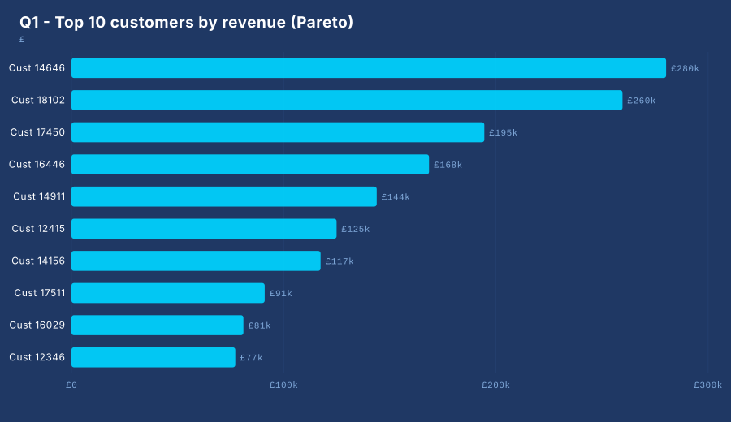
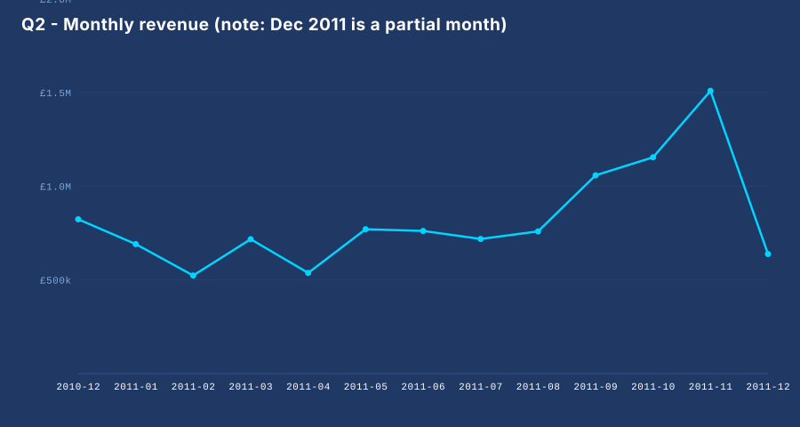
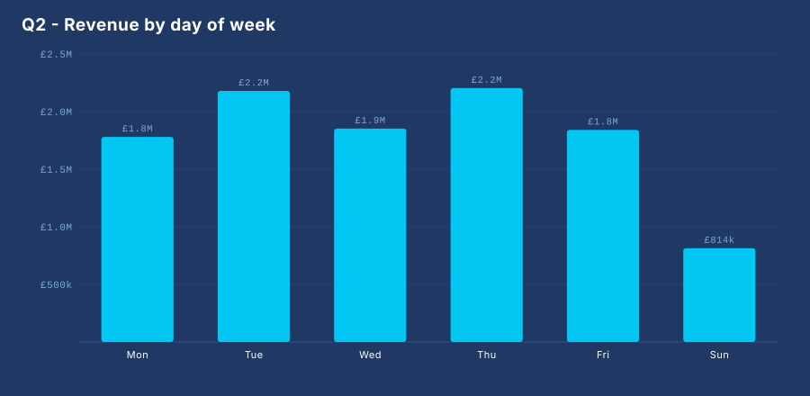
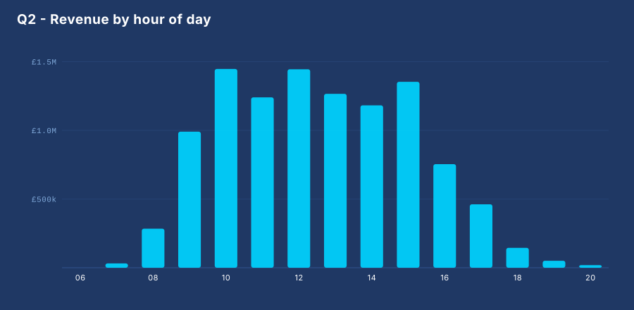
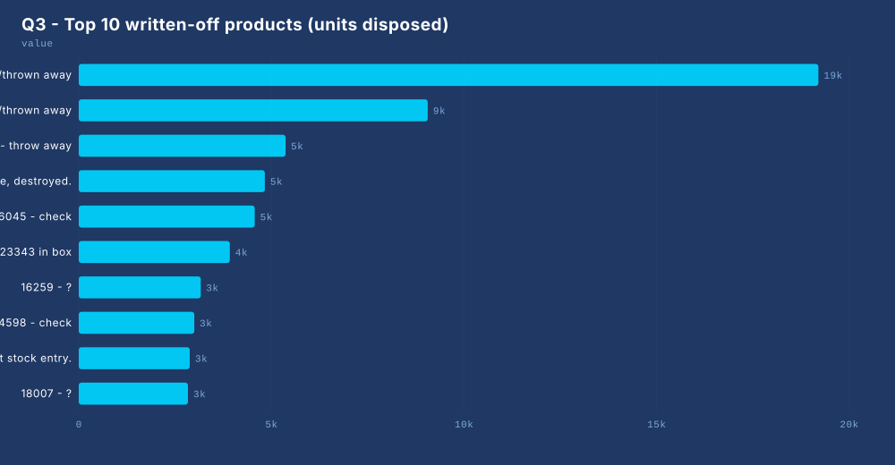
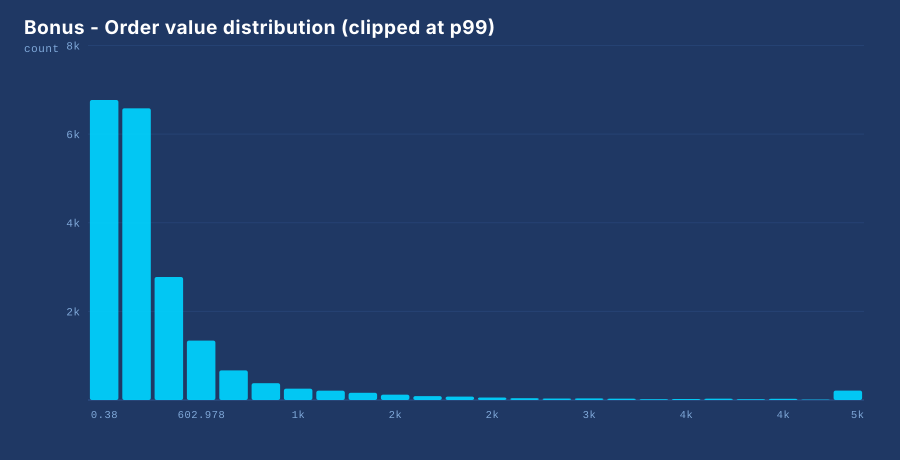
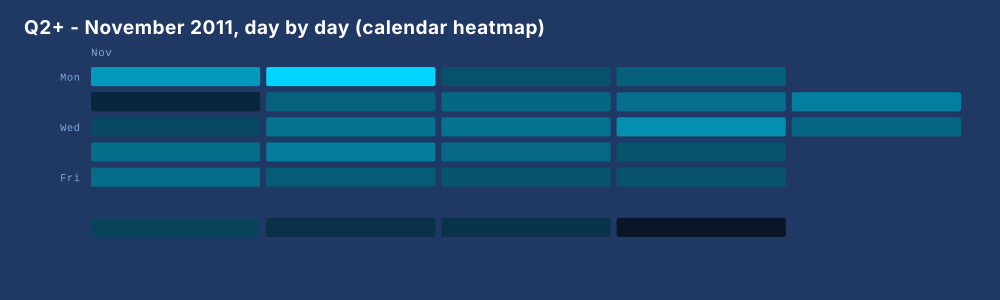
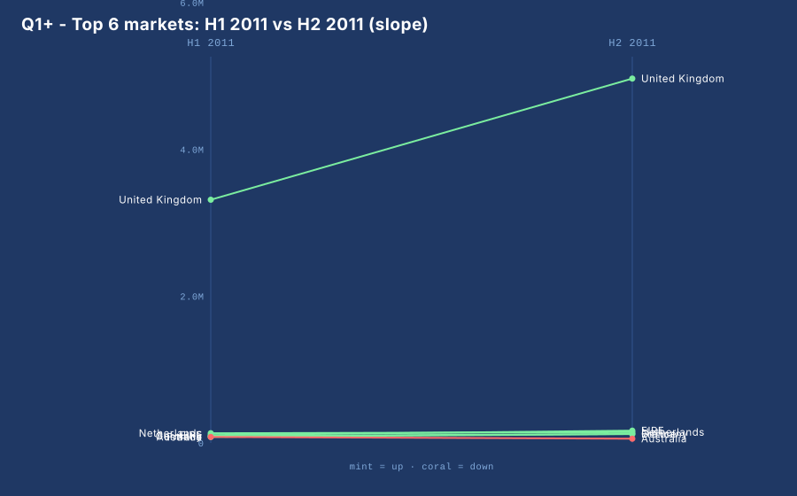
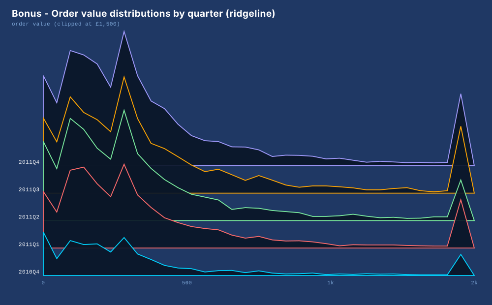
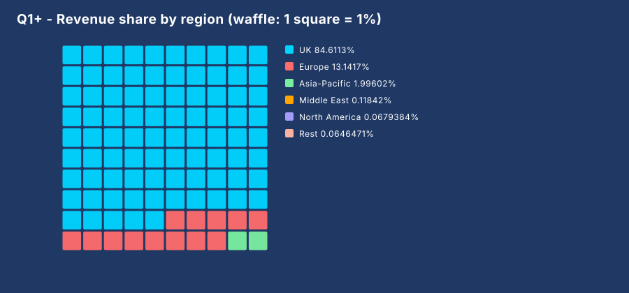

# Phase 2 — EDA Report: Online Retail

**The report in one sentence:** an 8-phase open-source roadmap's second project — 541,909 raw transactions cleaned into three business answers, visualized entirely by `src/vizz`, a chart library written from scratch with zero third-party imports.

> Every chart below is an actual file from [`charts/`](charts/) — generated by the exact code shown next to it. Question → code → chart → how to read it. That loop is the whole method.

**Reproduce it:**

```bash
python scripts/fetch_online_retail.py   # from the repo root, once
python src/analysis.py                  # from phase-02-eda/ — regenerates every chart
```

---

## 0. The data, and the six cleaning decisions

541,909 raw rows, 2010-12-01 → 2011-12-09 (note: December 2011 is a **partial month**). Raw is never analysis-ready — here is every decision, from `src/clean.py`:

| # | Rule | Rows affected | Why |
|---|------|---------------|-----|
| 1 | `InvoiceDate` parsed to real datetime | all | ISO text sorts, but doesn't do `.dt.month` |
| 2 | `Revenue = Quantity × UnitPrice` computed once | all | one definition, used by every chart |
| 3 | `InvoiceNo` starting with `C` = **cancellation** (credit note) | 9,288 | excluded from revenue — it's a refund |
| 4 | negative `Quantity` on a normal invoice = **write-off** | 1,336 | excluded from revenue — see Q3 for the twist |
| 5 | missing `CustomerID` = **flagged**, never dropped | 135,080 (24.9%) | dropping a quarter of the store to dodge a null is censorship |
| 6 | `UnitPrice ≤ 0` = **adjustment line** | 2,517 | carries no real revenue either way |

After cleaning, the **revenue-safe frame** (`sales`) is the single source of truth for every revenue number in this report: **£10,666,684** of gross sales.

---

## 1. Q1 — Revenue concentration: the Pareto view

**Finding:** the top 10% of customers generate **61.3%** of revenue, and just **212 customers (4.9%)** cover half of it. This is a wholesale business wearing a retail coat.



**The code that drew it:**

```python
cust = (sales[sales["HasCustomer"]]
        .groupby("CustomerID")["Revenue"]
        .sum()
        .sort_values(ascending=False))
share_top10pct = cust.head(max(1, int(len(cust) * 0.10))).sum() / total

fig = Figure(900, 520, "Q1 - Top 10 customers by revenue (Pareto)")
fig.barh([f"Cust {int(c)}" for c in top.index], top.values, prefix="£")
fig.save(CHARTS / "pareto_customers.svg")
```

**Why this chart:** horizontal bars because customer IDs are long labels; `barh` puts labels on the y-axis where they're readable. The concentration stats come from the *sorted cumulative* series — the chart is the evidence, the cumsum is the answer.

**How to read it:** one bar per customer, longest at the top. The first bar alone is ~2% of the whole company's revenue.

---

## 2. Q2 — Seasonality: when does the store earn?

**Finding:** revenue builds to a **November peak (£1.46M)** — holiday gifting — and concentrates in **weekday working hours** (Thursday is the best day at 20.7% of weekly revenue; peak hours 10:00–15:00). Staff and stock *before* November, not during it.



**The code that drew it:**

```python
monthly = sales.groupby(sales["InvoiceDate"].dt.to_period("M"))["Revenue"].sum()
fig = Figure(900, 480, "Q2 - Monthly revenue (note: Dec 2011 is a partial month)")
fig.line(labels, monthly.values, prefix="£")
fig.save(CHARTS / "monthly_revenue.svg")
```

**Why this chart:** a line, because the x-axis is *ordered time* — the slope between months IS the information. (Also read the title: the last point is a 9-day month, so the "crash" into Dec 2011 is an artifact, not a trend.)





**The code that drew them:**

```python
by_dow  = sales.groupby(sales["InvoiceDate"].dt.dayofweek)["Revenue"].sum()
by_hour = sales.groupby(sales["InvoiceDate"].dt.hour)["Revenue"].sum()

fig.bar([DOW[i] for i in by_dow.index], by_dow.values, prefix="£", value_labels=True)
fig.bar([f"{h:02d}" for h in by_hour.index], by_hour.values, prefix="£", label_every=2)
```

**How to read them:** same scale formula as the line chart, different geometry — vertical bars for short ordered categories. The weekday chart is a working-week signature (Saturday is nearly dead: this store sells B2B); the hour chart is a working-hours signature.

---

## 3. Q3 — "Returns" are two different problems wearing one label

**Finding (the headliner):** the rows everyone calls "returns" split into two completely different phenomena:

- **Cancellations** (C-invoices): 9,288 rows refunding **£896,812 — 8.4% of gross sales**. A *commercial* question.
- **Write-offs**: 1,336 negative-quantity rows on normal invoices — **all at UnitPrice = 0**, with descriptions like *"printing smudges/thrown away"*. Damaged stock disposed of. **Zero revenue impact** — an *operations* question.

Most analyses of this dataset lump both together and misprice both.



**The code that drew it:**

```python
writeoffs = df[df["IsReturn"]]     # flagged in clean(): negative qty, NOT a C-invoice
by_product = (writeoffs.groupby("StockCode")["Quantity"]
              .apply(lambda q: q.abs().sum())
              .sort_values(ascending=False).head(10))

fig = Figure(1000, 520, "Q3 - Top 10 written-off products (units disposed)")
fig.barh(labels, by_product.values)
fig.save(CHARTS / "top_written_off_products.svg")
```

**How the discovery happened:** the first draft of this analysis reported "revenue value of returns: £0" — which was *suspicious enough to investigate*. That's the EDA method working: a number that should be nonzero and isn't is a finding, not a bug in the report.

---

## 4. Bonus — the shape of one order

**Finding:** 19,960 orders; mean **£534**, median **£304**. Mean ≫ median = a long right tail: a few enormous wholesale orders pull the average up. Quote the median to describe a "typical" order.



**The code that drew it:**

```python
baskets = sales.groupby("InvoiceNo")["Revenue"].sum()
clip = baskets.clip(upper=baskets.quantile(0.99))   # one giant order would
                                                    # flatten every other bin
fig = Figure(900, 460, "Bonus - Order value distribution (clipped at p99)")
fig.histogram(clip, bins=24)
fig.save(CHARTS / "order_value_histogram.svg")
```

**Why the clipping:** the largest order is ~£168k. Without clipping, every bin except the last would be invisible. The clip is disclosed in the title — hiding it would be dishonest, showing it is hygiene.

---

## 5. The unconventional charts

Standard charts answer "how much per category". These four answer questions bars can't — and each one surfaced a finding the standard views missed.

### 5.1 Calendar heatmap — every day of the peak month at once



**Finding:** November 2011 earned **£1,509,496 across 26 days**; best day **Mon 14 Nov (£114,420)**. The weekly texture (dark weekends) and the mid-month surge are visible as *patterns* — 30 bars can't show a calendar's shape.

**The code that drew it:**

```python
nov = sales[(sales["InvoiceDate"].dt.year == 2011)
            & (sales["InvoiceDate"].dt.month == 11)]
daily = nov.groupby(nov["InvoiceDate"].dt.date)["Revenue"].sum()

fig = Figure(1000, 300, "Q2+ - November 2011, day by day (calendar heatmap)")
fig.calendar_heatmap(daily.index, daily.values)
fig.save(CHARTS / "calendar_nov2011.svg")
```

**How it works inside vizz:** each date maps to (week column, weekday row) — GitHub's contribution graph math — and color interpolates from dark navy to cyan via a two-stop gradient (`_lerp_color`). Color scales are just "position in range → interpolated hex".

### 5.2 Slope chart — how did each market move between halves?



**Finding:** UK grew **+50%** into H2, EIRE **+56%**, Germany +32%, France +49% — but **Australia shrank −29%**. The slope chart makes the one decliner unmissable; a grouped bar chart of the same data hides it in bar-length comparison.

**The code that drew it:**

```python
h1 = y2011[y2011["InvoiceDate"].dt.month <= 6].groupby("Country")["Revenue"].sum()
h2 = y2011[y2011["InvoiceDate"].dt.month > 6].groupby("Country")["Revenue"].sum()

fig.slope(list(top), [h1.get(c, 0) for c in top],
          [h2.get(c, 0) for c in top], left_label="H1 2011", right_label="H2 2011")
```

**How it works inside vizz:** both axes share ONE y-scale (that's what makes slopes comparable), each category is a two-point polyline, and color is semantic — mint for up, coral for down.

### 5.3 Ridgeline — the shape of order values, per quarter



**Finding:** medians barely move across five quarters (£259 → £305) — but Q4 2011 contains **5,628 orders vs 1,559** a year earlier. The *shape* of business is stable; the *volume* is what grew. Averages-based charts cannot say that.

**The code that drew it:**

```python
orders = q.groupby(["Quarter", "InvoiceNo"])["Revenue"].sum().reset_index()
series = sorted(((quart, g["Revenue"].clip(upper=1500))
                 for quart, g in orders.groupby("Quarter")), key=lambda t: t[0])

fig = Figure(1000, 620, "Bonus - Order value distributions by quarter (ridgeline)")
fig.ridgeline(series, bins=32, xlabel="order value (clipped at £1,500)")
fig.save(CHARTS / "ridgeline_order_values.svg")
```

**How it works inside vizz:** all groups share one set of bin edges (shapes must be comparable); each group becomes a filled polygon on its own baseline; baselines march up the canvas and polygons are drawn **back-to-front** so each ridge overlaps the one behind it — the overlap is the aesthetic and the information.

### 5.4 Waffle — revenue share in countable squares



**Finding:** **85 of 100 squares are the UK**; continental Europe is 13; everything else fits in 3 squares. A pie chart makes you compare angles; a waffle lets you count.

**The code that drew it:**

```python
mapping = pd.read_csv(regions_path).set_index("Country")["Region"].to_dict()
by_region = by_country.groupby(by_country.index.map(mapping)).sum()

fig = Figure(900, 420, "Q1+ - Revenue share by region (waffle: 1 square = 1%)")
fig.waffle(labels, values, total_squares=100, cols=10)
fig.save(CHARTS / "waffle_regions.svg")
```

**How it works inside vizz:** values become square counts via **largest-remainder rounding** — naive rounding gives 99 or 101 squares; the algorithm hands leftovers to the biggest fractional remainders so the grid is exactly 100.

---

## 6. Conclusions

1. **The business is a concentrated B2B wholesaler:** top 10% of customers = 61% of revenue; Thursday-daytime is the market; November is the year.
2. **"Returns" needed decomposing, not totaling:** £897k of cancellations (commercial) vs 1,336 zero-price write-offs (operational). Different owners, different fixes.
3. **Growth is volume, not value:** order counts grew ~3.6× year over year while the order-value distribution held steady — capacity planning, not pricing, is the lever.
4. **The chart library is the second product:** 9 chart types, zero dependencies, every chart in this report is ~5 lines of calling code.

## 7. Method notes

- Every number in this report was cross-checked between the Python engine (Phase 1) and SQL (Phase 1's rebuild task) — agreement between two independent implementations is the cheapest test suite there is.
- The broken-EDA exercise (`broken/`) contains the 8 bugs this pipeline is hardened against; `broken/broken_eda_fixed.py` is the corrected twin for side-by-side reading.
- Full day-by-day log: [`Journal.md`](Journal.md). Chart library: [`src/vizz/`](src/vizz/). Cleaning rules: [`src/clean.py`](src/clean.py).