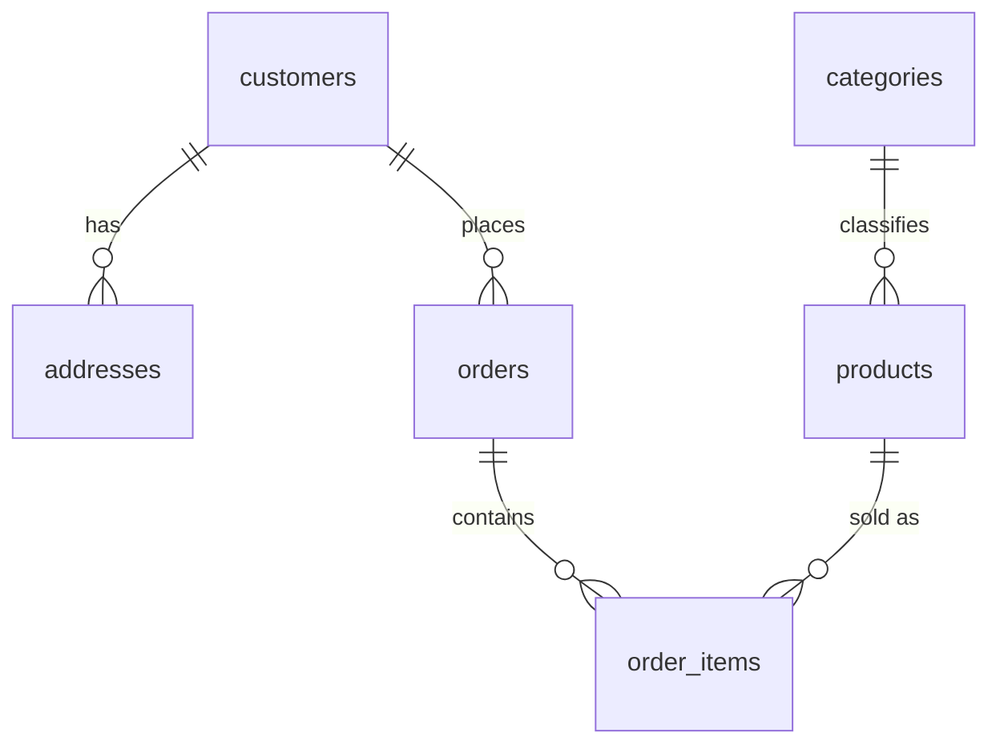
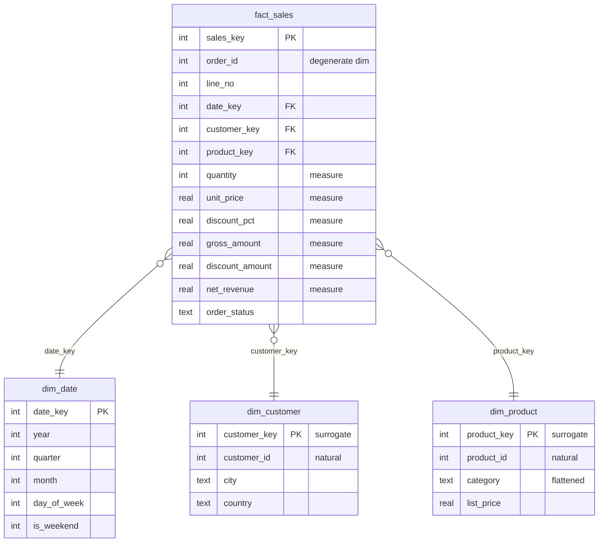

# Modeling Notes — one dataset, three models

This is the written half of Phase 3: the same StarMart data modeled three ways, with the actual outputs from the scripts. Read this after running the pipeline once.

```bash
python scripts/seed.py             # 1,200 customers · 300 products · 25,000 orders · 64,789 lines
python scripts/build_warehouse.py  # star DDL + ETL + indexes (reconciles to the cent)
python scripts/anomalies.py        # watch the legacy schema rot (all rolled back)
python scripts/compare.py          # same question, three schemas
```

The data is deterministic (`random.seed(42)`), so every number below reproduces exactly.

---

## 1. The legacy flat table — the anti-pattern

`legacy_orders`: one wide table, one row per order line, with the customer's name/email/city/country **and** the product's name/category copied into every row. It has no primary key, no foreign keys, no CHECK constraints — and **no status column at all**.

It reads fine. Here is what it does under pressure, from `scripts/anomalies.py`:

```
1. UPDATE ANOMALY — one customer, two cities
  customer            : aarav.barnes445@yahoo.com
  cities before       : ['London']
  cities after        : ['Newtown', 'London']   <-- the anomaly
  3NF equivalent      : 1 row updated — consistent by design

2. INSERT ANOMALY — the catalog cannot grow without a sale
  inserted with order_id=None, customer=None
  -> a catalog entry pretending to be an order line
  3NF equivalent      : INSERT INTO products — works standalone

3. DELETE ANOMALY — the customer exists only inside their order
  deleted all 6 line(s) for isla.patel540@outlook.com
  legacy rows left    : 0   <-- the customer is gone
  3NF equivalent      : customer_id 540 still exists in customers
```

The mechanism in all three: **one fact, stored many times**.

- The city `Paris` lived in 8 rows, so "update the customer's city" has 8 chances to fail partially. It did.
- A product is only representable as part of an order, so a new catalog item becomes a fake order with `NULL` customer.
- A customer is only representable through their orders, so deleting the orders deletes the customer.

No amount of careful SQL fixes this. It's the model.

---

## 2. Normalization: 1NF → 2NF → 3NF

The fix (`sql/02_normalized_3nf.sql`) splits "what a row is ABOUT" into one table per thing:

| Form | Rule | In this schema |
|------|------|----------------|
| **1NF** | every cell holds one atomic value | no comma-separated lists, no repeating groups |
| **2NF** | 1NF + no partial dependency | composite key `order_items(order_id, line_no)`: every column needs both halves |
| **3NF** | 2NF + no transitive dependency | city/country depend on the *customer*, not the order → `addresses`; category depends on the *product* → `categories` |



**What normalization buys:** every fact lives in exactly one place, so an update is atomic, an insert can't invent context, a delete can't orphan anything. The constraints do the enforcing: `CHECK (quantity > 0)`, `UNIQUE(email)`, `REFERENCES ...` — a typo like a 10% discount stored as `10` is rejected at write time.

**What it costs:** joins. A question about revenue-by-category-for-German-customers has to walk **six tables** (see §6).

---

## 3. Dimensional modeling: the star schema

Normalization optimizes for correct *writes*. Analytics optimizes for fast, simple *reads*. A star schema (`sql/03_star_schema.sql`) is built for the second job:



Four decisions, in order:

1. **Grain:** one row = one order line. Declared first; dimensions must describe exactly that.
2. **Facts = measures:** the five numeric columns you sum/divide. **Dimensions = context:** who/what/when, plus attributes to filter and group by.
3. **Surrogate keys:** `customer_key`/`product_key` are dense integers owned by the warehouse — independent of source IDs, which stay as ordinary columns for lineage. Integer joins are the cheapest joins.
4. **Star, not snowflake:** `category` is flattened into `dim_product` instead of joining `categories`. One less join on the hot path. Snowflaking reintroduces the hierarchy when you genuinely need it.

Two honest caveats were documented in the first version of this phase:

- `dim_customer` stores the **current default address only** — history is lost.
- `order_status` in the fact is a **current-state attribute**, not a history.

Both caveats are now **closed** — see §8, which builds a Type 2 SCD dimension and a returns fact at its own grain, then measures what the caveats actually cost.

---

## 4. The ETL

`sql/04_etl_3nf_to_star.sql` — dimensions first, then the fact.

| Star table | Source | Transformation |
|------------|--------|----------------|
| `dim_date` | generated | recursive CTE walks every date between MIN and MAX order dates → 731 rows |
| `dim_customer` | `customers` + default `addresses` | flatten; surrogate key via `ROW_NUMBER()` |
| `dim_customer_scd` | `address_changes` + `customers` | one row per VERSION: signup address from each mover's first change (old values) or the addresses table; `LEAD()` closes each version with the day before the next one |
| `dim_product` | `products` + `categories` | flatten category name; surrogate key |
| `fact_sales` | `order_items` + `orders` | map to dimension keys; compute measures once |
| `fact_returns` | `returns` + `orders` + `order_items` | one row per returned line, dated by the RETURN date |

Measures are computed **in the ETL**, not in every query — that's how every report agrees with every other report.

**Reconciliation** (`build_warehouse.py`) recomputes revenue independently on the source and compares:

```
star net revenue   : 11,410,030.36
3NF source revenue : 11,410,030.36
match              : YES
```

A first version of that check failed by exactly **£0.50** — because the star rounds money **per line** while the check summed unrounded values. Aggregating rounded values ≠ rounding the aggregate. That's the classic reason two dashboards disagree, and the check now compares like with like.

---

## 5. Same question, three schemas

The question: *"Revenue by category, for German customers, in 2025, excluding cancelled and returned orders."* From `scripts/compare.py`:

| Schema | Joins | Tables touched | Result | Median time |
|--------|-------|----------------|--------|-------------|
| Legacy flat | 0 | 1 | **£503,440.33** — wrong | 9.2 ms |
| 3NF | 5 | 6 | £482,499.57 | 74.6 ms |
| Star | 3 | 4 | £482,499.49 | 6.6 ms |

Three lessons in one table:

1. **The simplest query is wrong.** The flat table has no status column, so cancelled and returned lines cannot be excluded — it overstates revenue by **£20,940.84 (4.3%)**. It cannot even *ask* the question. Fewest joins, wrong answer: the most dangerous kind of simple.
2. **3NF and star agree to 8 pence** — the gap is line-level rounding, not a modeling difference. Correct models reconcile.
3. **The star is the fastest correct option**: 3 joins instead of 5, and measures pre-computed in the ETL. (Timings at 65k rows are illustrative; the structural argument — fewer joins, no re-deriving measures — is what scales.)

---

## 6. Indexing the fact table

The fact table's foreign keys are the join paths every query walks. `build_warehouse.py` indexes all three.

Date-range plan **with** `idx_fact_date`:

```
SEARCH fact_sales USING INDEX idx_fact_date (date_key>? AND date_key<?)
```

**Without** it:

```
SCAN fact_sales
```

Same story as Phase 1's `InvoiceDate` index — except here it's not one query, it's the join path of *every* analytical query. The monthly-grouping query shows the payoff directly:

```
SCAN d
SEARCH f USING INDEX idx_fact_date (date_key=?)
USE TEMP B-TREE FOR GROUP BY
```

`dim_date` is tiny (731 rows), so scanning it is free; the fact table (64,789 rows) is *searched*.

---

## 7. Transactions

From `scripts/anomalies.py`, the atomicity demo:

```
4. TRANSACTIONS — atomicity in 6 lines
  a two-step update failed mid-way -> rolled back
  discount total before: 3472.75
  discount total after : 3472.75
  unchanged            : YES
```

A transaction is all-or-nothing. Half-applied multi-step changes are how databases end up in states that "nobody could have caused". `BEGIN ... ROLLBACK` is the undo button — and it's also why the anomaly demos above can be safely re-run forever.

---

## 8. What the warehouse answers

Sample results from `sql/05_analytical_queries.sql`:

- **Monthly revenue:** seasonal by construction — 2024 November peaks at **£725,991.24** across 1,451 orders.
- **Weekend share:** weekdays **£10.04M (88.1%)** vs weekends **£1.36M (11.9%)** — a B2B-shaped business, same signature as Phase 1's retail dataset.
- **Discount leakage:** surprisingly flat — **5.4–5.6%** of gross across every category (Party highest at 5.55%). No category is discount-addicted; the policy is uniform.
- **Top customer:** Sofia Sharma (UK), **£44,627.79** across 88 orders.
- **Status mix 2025:** delivered 84.4%, shipped 8.7%, cancelled 2.9%, returned 2.1%, placed 1.9%.
- **QoQ growth by category:** available from the window-function query (`LAG` over quarterly totals) — the star's simplicity is what makes adding window functions trivial.

---

## 9. Closing the caveats: SCD Type 2 + returns at their own grain

The original star documented two caveats. This section builds the fixes and measures what they were worth.

### 8.1 `dim_customer_scd` — history survives

**Type 2 SCD**: one row per *version* of a customer. A move appends a version instead of overwriting history: `valid_from` / `valid_to` / `is_current`.

The 3NF source gained a proper change feed (`address_changes`) — and it records **old AND new** values. That "and old" is the trap: my first version of the feed stored only the new address, which silently destroyed every mover's signup address (the warehouse's "first version" was their *final* city). A change log must capture the before-state, or the past is unrecoverable.

The ETL reconstructs the event list — signup (old values of the first change, or the addresses table for non-movers) plus every move — and `LEAD()` closes each version the day before the next begins.

```
warehouse contents        reconciliation
  dim_customer_scd  1,281   SCD current rows   : 1200 = customers     YES
                            SCD total versions : 1281 = customers+moves YES
```

And it changes real answers:

```
S2. point-in-time: customer 26 on 2025-03-01
  Mumbai, India  (valid_from 2023-11-21, valid_to 2025-02-07)
  Delhi,  India  (valid_from 2025-02-08, current)
```

A current-state dimension can only say Delhi. The SCD says "they lived in Mumbai when their 2024 orders happened."

**The money demo** — 2024 revenue by city, current dimension vs SCD (only cities where the two disagree, i.e., mover revenue):

```
city          current_dim_revenue  scd_revenue  scd_minus_current
Edinburgh        526,805.35        487,154.28      -39,651.07
Amsterdam        126,975.17        149,295.02      +22,319.85
Rotterdam         67,862.28         47,166.21      -20,696.07
...29 cities differ...
```

Edinburgh's 2024 revenue is overstated by **£39,651** because movers who left are still counted there; Amsterdam is understated by £22,320. 29 cities disagree. That is the concrete price of a non-versioned dimension — not a theory, a number.

### 8.2 `fact_returns` — returns as events, not a status

Returns at their own grain: one row per returned line, dated by the **return date**, with quantity and refund as measures. The 3NF source gained a `returns` table (an OLTP event table — the right home for it).

```
refund reconciliation: star 102,808.71 = source 102,808.71   YES
```

The payoff — three questions the status-hack could not answer:

- **Refund rate by month**: 0.4%–1.7% of monthly sales revenue, spiking in December (1.67%) — seasonal return behavior, invisible from a status flag.
- **Refund rate by category**: Bags 1.1% down to Kitchen 0.64% — a ranking no status attribute can produce.
- **Partial returns are the norm: 669 of 912 returned lines (73%) come back partially.** A status column cannot say *"line 1 of order X came back 3 of 5 units on a different day"* — a fact table at return grain can.

### 8.3 What this stretch taught

1. **A change feed must capture before-state.** Otherwise the warehouse quietly rewrites history.
2. **Point-in-time queries are the SCD's superpower** — `WHERE d.full_date BETWEEN valid_from AND valid_to` turns "where do they live now" into "where did they live when".
3. **A status is not an event.** If the business asks *when*, *how much*, or *which part* — it needs a fact table.

---

## 10. Takeaways

1. **Normalize for writes, star for reads.** They are layers, not rivals: 3NF protects the source of truth; the star serves analytics.
2. **The grain decides everything.** Declare it before designing anything else.
3. **A simple query on a broken model is still a wrong answer** — legacy was the fastest and the only wrong one.
4. **Reconcile your ETL to the cent** — and compare like with like (per-line rounding).
5. **Constraints are the model.** Types don't stop a `10` where `0.10` belongs; `CHECK` does.
6. **Change feeds capture the before-state; status columns don't capture history.** SCD Type 2 and event-grain facts are the tools for time. Use them when the question contains "when", "which part", or "how much".
